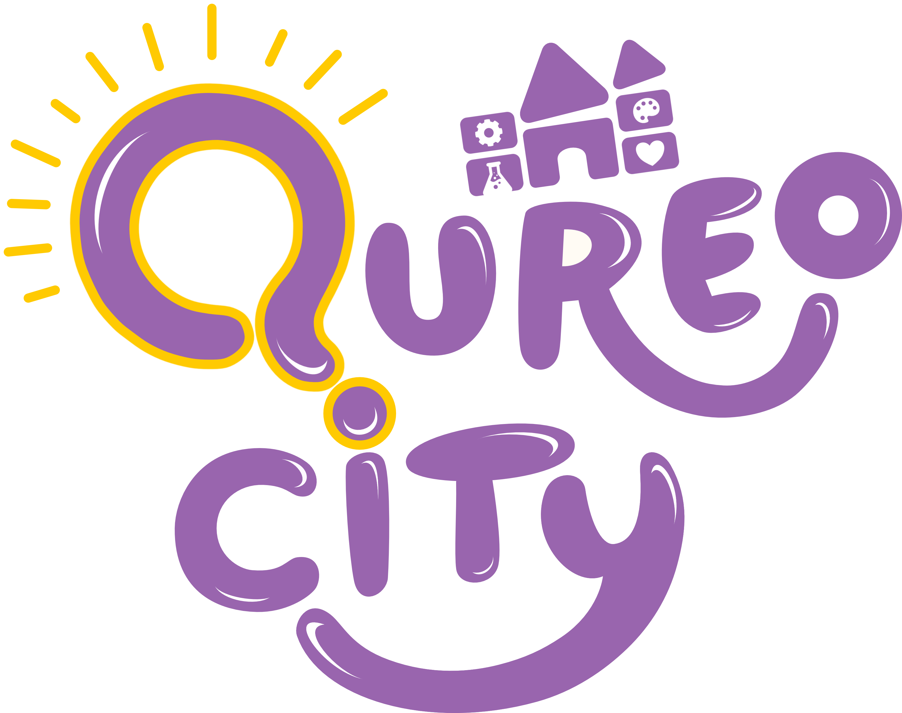
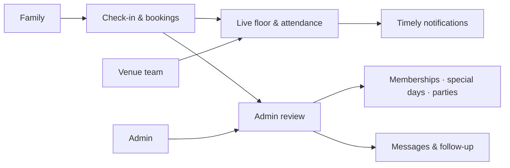

  

<h1 align="center">A better day at the play space.</h1>

  QureoCity brings the front desk, floor team, families, and venue operations into one calm, mobile-first workspace.

  
  
  
  

---

## One workspace, three perspectives

| **Families** | **Employees** | **Admins** |
|:--|:--|:--|
| Walk in, register, renew a membership, choose a special-day pass, or request a party. | Scan in for a shift, see who is on site, check children in or out, and find customer records. | See the day at a glance, manage customers and plans, review requests, coordinate staff, and keep venue settings in one place. |

## From arrival to follow-up

## Made for the rhythm of a busy venue

- **Know what’s happening now** — daily check-ins, live occupancy, session timers, and team attendance.
- **Find the right family quickly** — searchable child and parent records, membership status, plans, and visit history.
- **Keep registrations moving** — review membership and special-day requests; approve, decline, quote, and confirm party bookings.
- **Coordinate the team** — shifts, QR-based punches, attendance history, editable records, and payable-to-date salary estimates.
- **Reach people at the right moment** — role-aware push alerts, saved message formats, birthday outreach, and membership-expiry reminders.
- **Stay in control** — configurable kiosk and desk access, notification preferences, and selectable data exports.

## Designed around the floor

Fast, touch-friendly views keep everyday actions close at hand on phones and desktops. Admin tools stay organized around the work: **Overview · Customers · Notifications · Plans · Staff · Settings**.

QureoCity · Venue operations, made clearer.

